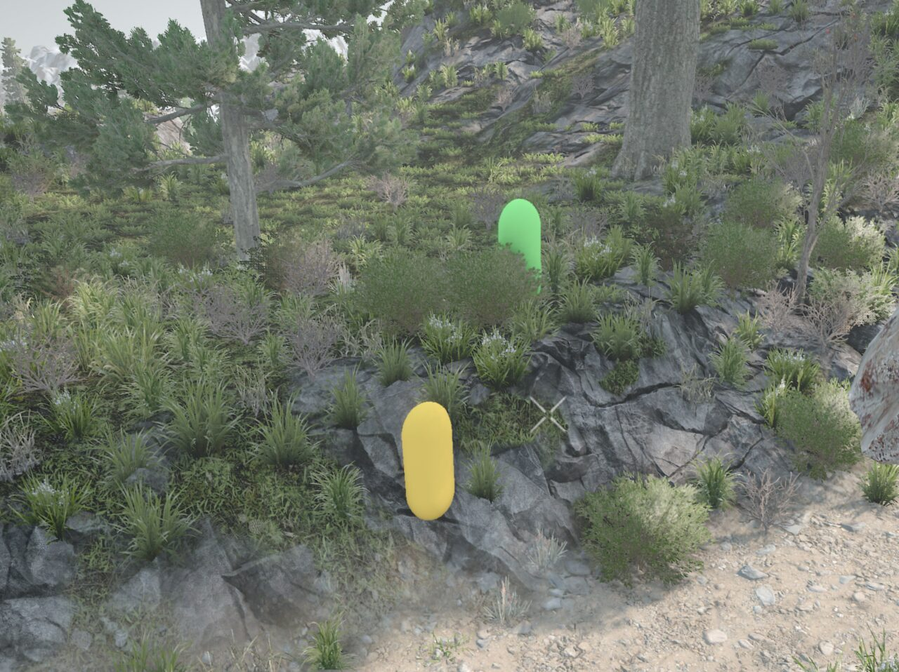
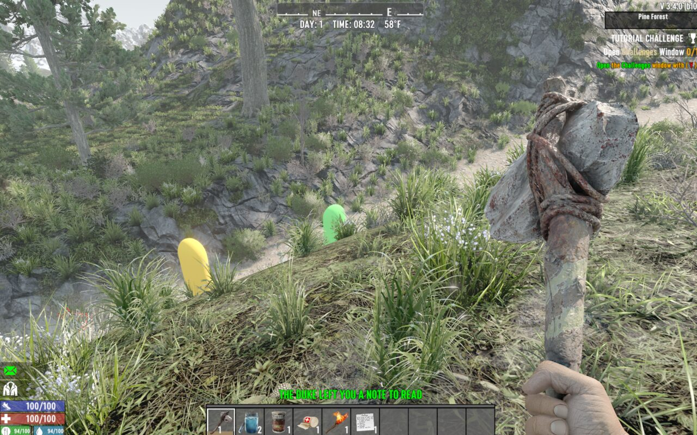
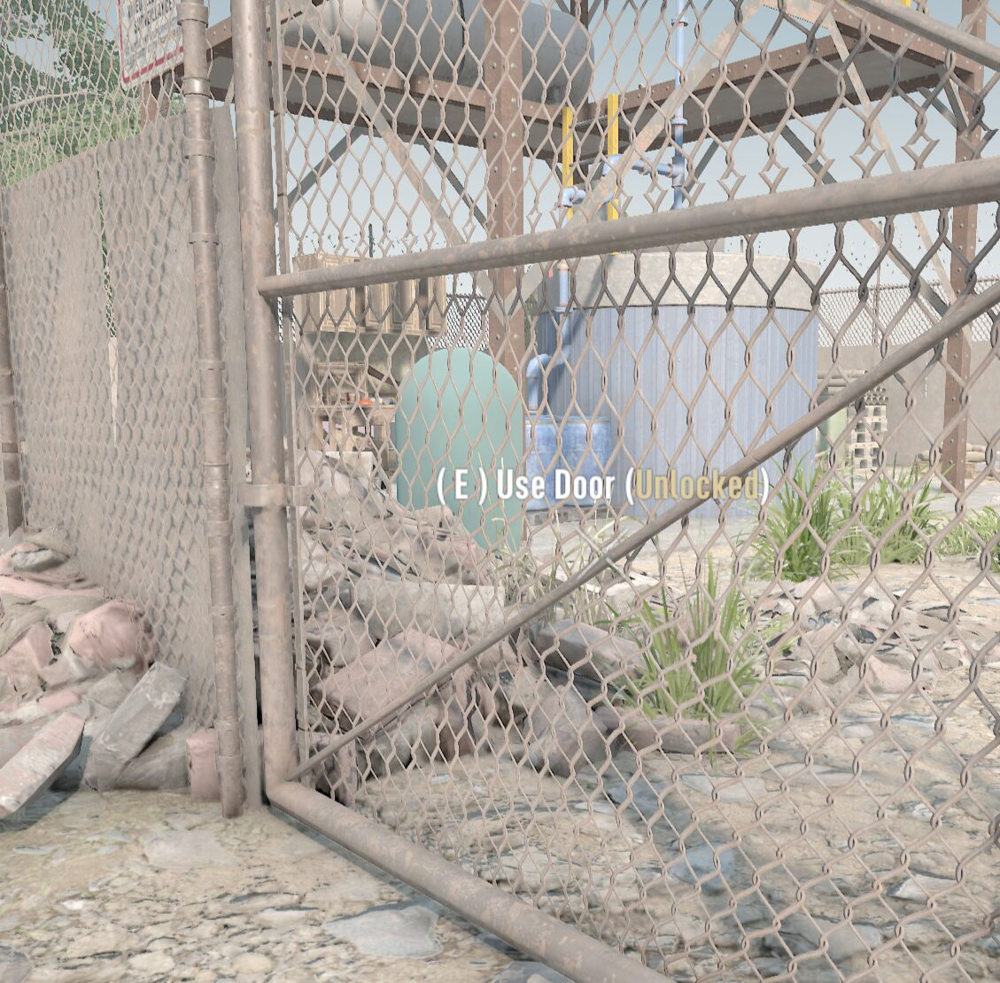
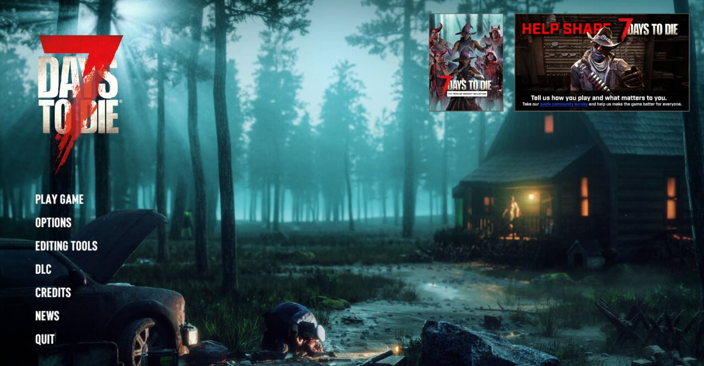
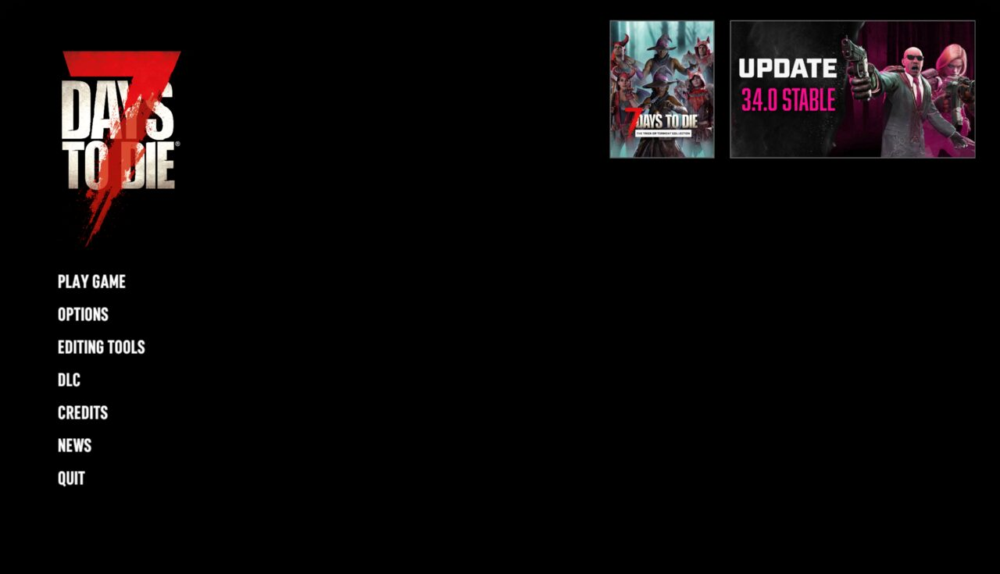

# 7 Days to Die — For Kids

A simple mod that makes 7 Days to Die less scary for children.
Zombies become colored capsules, gore is removed, and scary images are hidden.

> ❤️ **Dedicated to Facundo.**
> I made this mod so I could play 7 Days to Die with my son Facundo, when he was 8 years old.

> This is a small home-made mod, not a polished product.
> **An adult should try it first** before letting kids play.

**Tested with:** 7 Days to Die **V 3.4.0 (b10)**, Windows, single player. Linux install is supported too (`install.sh`).

---

## What the mod changes

| Area | Change |
|---|---|
| **Zombies** | Shown as solid colored capsules. Each zombie type has its own color (blue, red, green...), and **always keeps that color**, so after a while kids learn to recognize each zombie by its color. Feral / radiated / charged / infernal versions use a lighter or darker shade of the same color. |
| **Attacking animals** | Zombie dog, zombie bear, zombie boar, zombie vulture, wolf, dire wolf and coyote are colored capsules too, sized to match the animal. |
| **Other animals** | Look normal: the wild (non-zombie) boar, and also deer, rabbits, chickens, bears, snakes and mountain lions. |
| **Zombie names** | Kid-friendly names, e.g. "Arlene the Blue". English only. |
| **Gore** | Gore piles, corpses and similar decorations are replaced with rubble. Hits show stone sparks instead of blood. No dismemberment. |
| **Startup screen** | The "Signing into services..." background image is turned black. |
| **Main menu** | The animated background video (with zombie images) is removed; the menu has a black background. The small news banners in the top right come from the game's online news and are not changed. |
| **Loading screens** | Background images are removed; the screen stays black. Tips are still shown. |
| **Death screen** | When you die, the blood on the screen and the red "dying" effect are removed. |
| **Sounds** | **Sounds are kept.** Zombie growls, screams and attack sounds are the original ones. |

---

## What it looks like

**Zombies are colored capsules.** Each zombie type always has the same color, so you can start to recognize them.







**Attacking animals** (wolves, coyotes, zombie dogs...) are colored capsules too. The wild boar is not changed.

**Scary images are replaced with a black screen.** This includes the main menu background, the startup screen and the loading screens.

| Without the mod | With the mod |
|---|---|
|  |  |

**Sounds are kept.** You still hear zombies growl and attack. This helps you know when one is close, but some kids may find the sounds scary.

---

## Install on Windows (easy way)

1. **Download** the latest `7DaysForKids-vX.Y.Z.zip` from the
   **[Releases page](https://github.com/mblua/7dtd-for-kids/releases/latest)**.
   (The green **Code → Download ZIP** button also works; it includes the source code too.)
2. **Extract** the ZIP (right-click → *Extract All*). Do not run it from inside the ZIP.
3. **Close the game** if it is open.
4. **Double-click `install.bat`.**
   - It looks for the game in your Steam libraries.
   - If it finds it, it asks you to confirm. If not, it asks you to type the game folder.
5. **Start the game with EasyAntiCheat (EAC) turned off.** Mods with code do not load while EAC is on.

You can also give the game folder directly:

```bat
install.bat "D:\SteamLibrary\steamapps\common\7 Days To Die"
```

**Where is the game folder?** In Steam: right-click *7 Days to Die* → *Manage* → *Browse local files*.
It is usually one of these:

- `C:\Program Files (x86)\Steam\steamapps\common\7 Days To Die`
- `<Drive>:\SteamLibrary\steamapps\common\7 Days To Die`

Run `install.bat` again after every update of this mod. It only touches the `Mods\7DaysForKids` folder.

## Install on Linux / Steam Deck (easy way)

Works with the native Linux version of the game (and with the Windows version under Proton).

1. **Download** and **extract** the ZIP (or `git clone` the repo).
2. **Close the game** if it is open.
3. Open a terminal in the extracted folder and run:

   ```bash
   ./install.sh
   ```

   - If you get `Permission denied`, run `chmod +x install.sh` first (or use `bash install.sh`).
   - It looks for the game in your Steam libraries (`~/.local/share/Steam`, `~/.steam/steam`, Flatpak and Snap Steam,
     plus any extra library listed in `libraryfolders.vdf`) and asks you to confirm.
   - You can also give the game folder directly:

     ```bash
     ./install.sh "$HOME/.local/share/Steam/steamapps/common/7 Days To Die"
     ```
4. **Start the game with EasyAntiCheat (EAC) turned off** (see below).

**Where is the game folder?** In Steam: right-click *7 Days to Die* → *Manage* → *Browse local files*.
Usually `~/.local/share/Steam/steamapps/common/7 Days To Die`.

Run `./install.sh` again after every update of this mod. It only touches the `Mods/7DaysForKids` folder.

**Manual install on Linux:**

```bash
cp -r Mods/7DaysForKids "$HOME/.local/share/Steam/steamapps/common/7 Days To Die/Mods/"
rm -rf "$HOME/.local/share/Steam/steamapps/common/7 Days To Die/Mods/7DaysForKids/Scripts"   # optional
```

### Turning EAC off

- **With the launcher:** start the game from Steam and untick *Use EasyAntiCheat* in the 7 Days to Die launcher.
- **If the launcher does not show up** (it was hidden with "don't show again"): edit the launcher settings file and
  set `"UseEAC" : false` (you can also set `"ShowLauncher" : true` to get the launcher back):
  - Windows: `%APPDATA%\7DaysToDie\launchersettings.json`
  - Linux: `~/.local/share/7DaysToDie/launchersettings.json`

## Install (manual way, Windows)

1. Copy the folder `Mods\7DaysForKids` from the download into the game's `Mods` folder.
   You do not need the `Scripts` folder inside it.
2. The result must be: `<game folder>\Mods\7DaysForKids\ModInfo.xml`
3. Start the game with EAC turned off.

## Uninstall

Delete the folder `<game folder>\Mods\7DaysForKids` (on Linux: `<game folder>/Mods/7DaysForKids`).

---

## Known limitations

- **Aiming takes practice.** Hits are counted on the real (invisible) zombie body, not on the capsule. The capsule does not match the body perfectly.
- Sounds are the original ones (screams, growls...).
- Zombie names are only in English.
- Loot from a killed zombie appears as a small rubble pile on the ground.
- After a game update, parts of the mod may stop working until the mod is updated.

## Troubleshooting

- **Nothing changed in the game:** make sure EAC is off, and that `Mods\7DaysForKids\ModInfo.xml` exists in the game folder.
- **Check the log:** open `%APPDATA%\7DaysToDie\logs\` (Linux: `~/.local/share/7DaysToDie/logs/`) and look at the newest `output_log_client_*.txt`.
  Search for `[7DaysForKids]`. Lines with `NOT FOUND` or `FAILED` show what broke.
- **`Mods\0_TFP_Harmony` missing:** the mod needs it. In Steam use *Verify integrity of game files*.

---

## For developers

The mod has two parts:

- `Mods/7DaysForKids/Config/` — XML patches (blocks, entity classes, loading screen, menu windows) and `Localization.csv`.
- `Mods/7DaysForKids/Scripts/` — C# Harmony patches, compiled into `Mods/7DaysForKids/7DaysForKids.dll`:
  - `ZombieSolidColorPatch.cs` — capsules and colors (`EModelBase.Init`).
  - `DeathScreenPatch.cs` — death screen effects (`EntityPlayerLocal`).
  - `LoadingScreenPatch.cs` — black loading screen (`XUiC_LoadingScreen.OnOpen`).
  - `StartupBackgroundPatch.cs` — black startup background (`NGUIWindowManager`, window `MainMenuBackground`).
  - `ModInit.cs` — entry point; logs whether each patch target exists.

### Build

Requires the .NET SDK (6 or newer). The project targets .NET Framework 4.8 and references the game DLLs.

```bat
cd Mods\7DaysForKids\Scripts
dotnet build -c Release -p:GameDir="D:\SteamLibrary\steamapps\common\7 Days To Die"
```

The output `7DaysForKids.dll` is written to `Mods\7DaysForKids\`. Commit it, so players do not need to build.

### Release

Bump `<Version>` in `7DaysForKids.csproj` and `ModInfo.xml`, rebuild, commit, then publish a GitHub Release
(tag `vX.Y.Z`) with a ZIP that contains only `install.bat`, `install.sh`, `README.md` and `Mods\7DaysForKids` (without `Scripts`).

### Updating after a game update

1. Rebuild against the new game DLLs. Compile errors show renamed types or methods.
2. Check that every XML `xpath` in `Config/` still matches the game's `Data/Config` files.
3. Patch targets passed as strings (method and field names) are not checked by the compiler. `ModInit.cs` logs `NOT FOUND` for them at startup.
4. Mod localization must be a `Localization.csv` file using the same columns as the game's own file.
